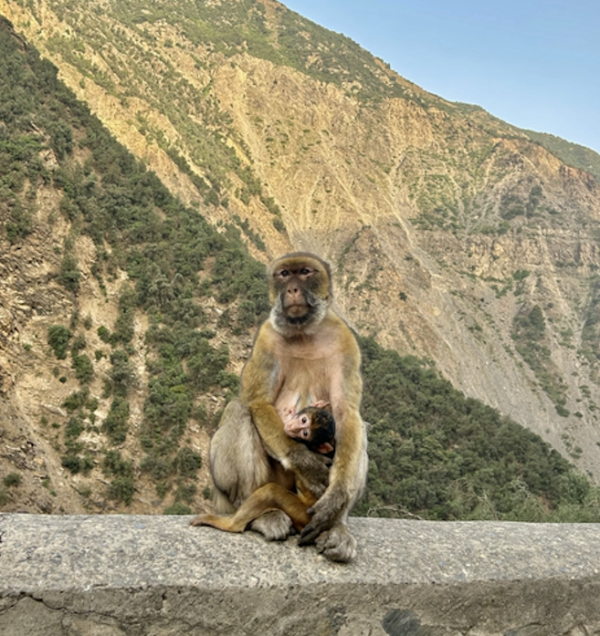
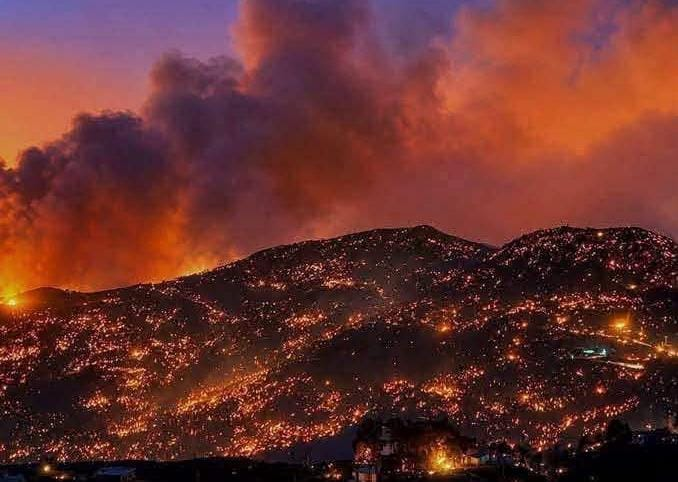

# Introduction

The Barbary Macaque (*Macaca sylvanus*)  is North Africa’s only primate and has been classified as endangered by the [IUCN Red list](https://www.iucnredlist.org/search?query=Macaca%20sylvanus&searchType=species) as of 2008. The species occupies a small and heavily fragmented range within forested regions of Morocco and Algeria, along with a small introduced population on Rock of Gibraltar. It faces critical threats from deforestation, urbanization, agriculture, and human disturbances driven primarily by tourism.

```{r}
#| echo: false
#| warning: false
#| message: false
#| fig-cap: "Barbary Macaques pictured in the Chiffa Gorge in Blida, Algeria. Photo: Louiza Mohamed-Cherif"
#| fig-align: center




```

Algeria holds nearly 25% of the Barbary Macaque’s global population, however there is a crucial need for new reviews as a comprehensive census of the existing populations within the country does not exist ([Boumenir et al ., 2025](https://pmc.ncbi.nlm.nih.gov/articles/PMC12248802/#B1-animals-15-01860)) Even more pressing, recent dry seasons driven by climate change have worsened regional wild fires, which overlap significantly with what remains of Algerian macaque habitat.

```{r}
#| echo: false
#| warning: false
#| message: false
#| fig-cap: "A wildfire across a forested mountain in Northeast Algeria. Photo: Hafid Derradji/Facebook via Morocco World News "
#| fig-align: center




```

In the summer of 2026 [nearly 160 wildfires broke out within a 24 hour period](https://reliefweb.int/report/algeria/dza-fire-07-2026-algeria-wildfires-july-2026-2026-07-22), stretching along the coastline of Algeria. These fires were felt across the north-eastern, central, and western portions of the country, with the highest intensity occurring in the north-east. The rapid scale and severity of these fires within such a short time frame signifies an urgent need to asses their impact on vulnerable wildlife habitat.

This study aims to map the spatial intersection of 2026 wildfire damage with known macaque habitat to estimate recent habitat loss. Wildfire damages intersect with protected areas will also be evaluated, to determine whether existing conservation frameworks are effectively safeguarding the Barbary Macaque.

# Methods

1.  The area of interest was first defined as a region of approximately 50,028.83km^2^, surrounding the forested coastline of northeast Algeria. The AOI contains about 2092km^2^ of protected land; It encompasses nearly the entirity of Algerian macaque habitat, however excludes a singular small patch located in Blida (a few miles southwest of Algiers, falling outside the region of highest fire concentration).

2.  Relevant data sets pertaining to land cover class, burned area, species range, known protected land, and occurrence (?) were cleaned and cropped to a bounding box within the study area.

3.  Suitable habitat range was defined as areas where tree-cover intersects with known habitat range polygons. This represented a total area of about 648\~ km\^2 within the study region.

4.  The overlapping area between defined suitable habitat and burned area polygons was calculated using st_intersection(), the total square km of habitat exposed to fire was then calculated using st_area().

5.  Intersect with burned and area was calculated for protected areas.

6.  known species occurrence points (?)

```{r}
#| echo: false
#| warning: false 
#| message: false
#| results: false
library(tidyverse)
library(kableExtra)
library(htmlwidgets)
library(widgetframe)
library(sf)
library(terra)
library(rgbif)
library(geodata)
library(greenSD)
library(dplyr)
library(dygraphs)
library(stringr)
```

## Data:

```{r}
#| echo: false
#| warning: false
#| message: false
#| results: false
#1. Define study area bounding box (Northeast Algeria)

# 1.1 define longitude and latitude:
boundbox_coords <- c( xmin = 3.0,
                      ymin = 36.3,
                      xmax = 8.6,
                      ymax = 37.2)


#2. Create an sf bounding box polygon + set crs
# 2.1 set an sfc object to hold spatial geometries:
boundbox_poly <- st_as_sfc(st_bbox(boundbox_coords, crs = 4326))
#view(boundbox_poly) # 2.2 check that polygon returns intended geography
#plot(boundbox_poly) # 2.3 draws a rectangle with no data
#3. find the area of the bounding box 
#boundbox_projected <- st_transform(boundbox_poly, crs = 32632)
#area_m2 <- st_area(boundbox_projected)
#area_m2  

```

## 1. ESA World Cover For Tree Cover Data

Land cover data downloaded from ESA World Cover from the year 2021, masked to Tree Cover.

```{r}
#| label: download_landcover
#| cache: false
#| warning: false 
#| message: false
#| results: false

#1 Download ESA landcover to desired extent
lancov_extent <- get_esa_wc(bbox = boundbox_poly, year = 2021, datatype = "landcover", mask = TRUE, quiet = TRUE )
#plot(lancov_extent) to view 
# 1.2 isolate tree cover data: numeric code "10"
tree_cover <- ifel(lancov_extent == 10, lancov_extent, NA) # 1.3 treats all other data as NA 
levels(tree_cover) <- data.frame(id = 10, cover = "Tree Cover") # 1.4 renames legend to "tree_cover" 
plot(tree_cover, main = "Tree Cover In Northeast Algeria", col = "forestgreen")
```

## 2. Species Occurrence Points

Occurrence points collected from the Global Biodiversity Information Facility (gbif) - may be excluded from final- see notes at end of page.

```{r}
#| label: download_occ_pt
#| cache: false
#| warning: false 
#| message: false 
#| results: false
#2. Download species point data at desired extent 
bounding_box <- st_as_text(boundbox_poly) # 2.1 translates polygon to text  
occ_data <- occ_search(scientificName = "Macaca sylvanus", hasCoordinate = TRUE, geometry = bounding_box ) # 2.2 pulls occurence data with coord info within bounding box 
occ_df <- occ_data$data # 2.3 extracts cleaned observation records 
occ_sf <- st_as_sf(occ_df, 
                   coords = c("decimalLongitude", "decimalLatitude"), 
                   crs = 4326, 
                   remove = FALSE) # 2.4 converts occurence data to sf object 

# == 2.5 run a test plot to see if points fall in desired study area == # 
plot(tree_cover, main = "Tree Cover & Macaca sylvanus Occurrences", col = "forestgreen")
plot(st_geometry(occ_sf), col = "orange", pch = 16, cex = 0.5, add = TRUE)
```

## 3. Species Range Map

Habitat range as defined by the IUCN red list.

```{r}
#| label: download_sp_range
#| cache: false
#| warning: false 
#| message: false 
#| results: false
#3. Download IUCN redlist species bounds at desired extent 
IUCN_range <- st_read("data/MacacaSylHab_range/T12561A50043570.gpkg") # 3.1 read in range data 
macaque_range <- st_transform(IUCN_range, crs = 4326) |> st_crop(boundbox_poly) # 3.2 crop to study area 

# == 3.3 run a test plot to ensure study area covers range == # 
plot(tree_cover, main = "Tree Cover & IUCN Macaque Range", col = "forestgreen")
plot(st_geometry(macaque_range), border = "red", lwd = 1.0, add = TRUE) #note to self : make some adjustments to bounding_box 
```

## 4. Burned Area Data

VIIRS/NPP Burned Area Monthly L4 Global 500m SIN Grid V002, from 1 June 2026 to 31 October 2026 (Date range stretched to include the entire summer fire season).

```{r}
#| warning: false 
#| message: false 
#| results: false
#| error: false
#4. Download burned area dataset at desired extent 
#The "Burned area" folder contains five files, they will need to be combined into a single sf for ploting. 
burn_files <- list.files("data/Burned_area", pattern = "\\.hdf$", full.names = TRUE) 
dates <- unique(regmatches(basename(burn_files), regexpr("A[0-9]{7}", basename(burn_files))))# 4.1 extract unique dates from burn_files ; MODIS date tags begin with A and follow the 4 digit year, 3 day date format ({7}), [0-9] matches any digit from 0 - 9 -> the complete extraction code is thus "A[0-9]{7}"
burn_rasters <- lapply(burn_files, rast, subds = 1) # 4.2 loops through each file, opens subdataset "1" (contains burn data), and stores each raster in "burn_rasters" 
burned_total <- app(rast(burn_rasters), fun = max, na.rm = TRUE) # 4.3 combine layers into one raster 
burned_total[burned_total <= 0] <- NA # 4.4 turn non-fire pixels into NA values 
burned_poly <- as.polygons(burned_total, dissolve = TRUE)# 4.7 convert burned_total to a polygon
burned_sf <- st_as_sf(burned_poly) |> 
  st_transform(st_crs(boundbox_poly)) |>
  st_make_valid() |> 
  st_intersection(boundbox_poly) # 4.6 convert to sf file and crop to bounding box 

##== 4.7 run a test plot == ## 

plot(tree_cover, col= "forestgreen", main = "Burned Areas in Northeast Algeria: Summer of 2026 ")
plot(st_geometry(burned_sf), pch = 4, col = "red", cex = 0.6, add = TRUE)


  
```

## 5. Protected Areas

World Database on Protected and Conserved Areas (WDPA), filtered to most recent data set (2026).

```{r}
#| label: download_protected_areas
#| cache: false
#| warning: false
#| message: false
#| results: false 
#5. Download protected area dataset at desired extent 
gdb_file <- "data/WDPA_gdp/WDPA_WDOECM_Nov2026_Public_DZA.gdb"
# 5.1 Note to self:used st_layers(gdb_file) to read what the folder contains 
protected_areas_sf <- st_read(gdb_file, layer = "WDPA_WDOECM_poly_Nov2026_DZA") # 5.2 convert WDPA polygon to sf
protected_areas <- st_intersection(protected_areas_sf, boundbox_poly) # 5.2 crop to bounding box 

## == 5.3 run a test plot == ##
plot(tree_cover[[1]], main = "Protected Areas", col = "forestgreen")
plot(st_geometry(protected_areas), col = "gold", add = TRUE )

```

# Data Processing & Analysis

## 1. Creating a suitable habitat raster

```{r}
#| warning: false 
#| error: false
#| results: false
#1. Create assumed suitable macaque habitat 
macaque_habitat_raster <- mask(tree_cover, vect(macaque_range)) 
plot(macaque_habitat_raster, main = "Macaque Habitat ", col = "forestgreen")
#2. Convert habitat raster to a sf to calculate area 
habitat_sf <- macaque_habitat_raster |> 
  as.polygons() |> 
  st_as_sf()
hab_area <- st_area(habitat_sf) #Macaque Habitat covers an area of 648879725 square meters/ 648~ km^2 

```

## 2. Calculating total habitat burned

```{r}
#| warning: false
#| message: false
#| results: false 
#| error: false
burned_sf <- st_make_valid(burned_sf)
habitat_sf <- st_make_valid(habitat_sf)
#2. Calculate the overlap of burned area and macaque habitat 
burned_hab_union <- st_union(burned_sf) # 1.1 union ensures burned area is one combined total 
burned_hab_union <- st_make_valid(burned_hab_union)
# 2.2 intersect burned area with habitat 
burned_hab <- st_intersection(burned_hab_union, habitat_sf)
# 2.2.1 - check by running plot(burned_hab)
# 2.3 calculate total area burned 
burned_area <- burned_hab |> 
  st_as_sf() |>  # 1.3.1 convert burned_hab back into an sf before passing to st_area 
  mutate(burned_area = st_area(x)) # 1.3.2 "x" notates the geometry column in burned_hab, st_area is used to calculate the total area of the intersection - this can then passed into the percent calculation - burned_area is approx. 40.5km2 

# 2.4 find percent habitat burned 
percent_burned <- (as.numeric(burned_area$burned_area)/as.numeric(hab_area))*100 


# percent_burned --  6.23% of habitat in the northeast was burned in ONE SUMMER! That's not good! 

```

## 3. Calculating protected areas burned

```{r}
#| warning: false
#| message: false
#| results: false 
#3. Find intersect of protected areas and habitat 
# 3.1 follow same steps as when calculating total habitat burned 
protected_areas <- st_make_valid(protected_areas)
protected_union <- st_union(protected_areas) 
protected_union <- st_make_valid(protected_union) # 3.1.2 combine protected area + make valid so r does not run into processing issues later on 
protected_hab <- st_intersection(protected_union, habitat_sf)
# 3.2 check that everything plots correctly 
#plot(st_geometry(protected_hab))
# 3.3 intersect burned habitat with protected habitat 
burned_protected_hab <- st_intersection(protected_union, burned_hab) 
burned_protected_area <- burned_protected_hab |> 
  st_as_sf() |> 
  mutate(burned_protected_area = st_area(x)) 

# 3.4 find percent of habitat that falls in protected area 
protected_hab_area <- protected_hab |> 
  st_as_sf() |> 
  mutate(protected_hab_area = st_area(x)) # 3.4.1 find area covered by protected habitat 
percent_hab_protected <- (as.numeric(protected_hab_area$protected_hab_area))/ as.numeric(hab_area)*100 
percent_hab_protected
# 3.4.3 percent_hab_protected -- 36.21% of habitat falls in protected areas 

# 3.5 find percent of TOTAL macaque habitat that is both burned and protected 
#Out of all macaque forest, how much was burned in protected land? 
percent_total_hab_burned_protected <- (as.numeric(burned_protected_area$burned_protected_area))/ as.numeric(sum(hab_area))*100
#percent_total_hab_burned_protected -- 3.5.1 protected land accounts for about 4.0% of total habitat loss- the majority of habitat loss occured within protected forest! 

# 3.6 find percent of PROTECTED macaque habitat that was burned 
#Within protected areas, how much habitat was burned? 
percent_burned_protected <- as.numeric(burned_protected_area/protected_hab_area)*100
percent_burned_protected # 3.6.1  percent_burned_protected --> Out of protected habitat, 11.06% was burned! 

# 3.7 11.06% is pretty bad,  Lets find out the percent of protected areas in total that were burned: 
burned_protected_all <- st_intersection(protected_union, burned_hab_union)
burned_protected_area_all <- burned_protected_all |> 
  st_as_sf() |>
  mutate(burned_protected_area_all = st_area(x))

protected_areas_all <- protected_union |> 
  st_as_sf() |>
  mutate(protected_areas_all = st_area(x))

  
percent_of_all_protected_burned <- (as.numeric(burned_protected_area_all$burned_protected_area_all) / as.numeric(protected_areas_all$protected_areas_all)) * 100

# 3.7.1 percent_of_all_protected_burned -- 4.67% of protected area was burned


```

## 

## 5. Final validation with species occurrence points

Notes: did not specify year when pulling occurrence data from GBIF, I'm going to try filtering to recent years first- if it does not return enough points for validation it may be better to cut species points out of the study rather then use outdated occurrences, but I have not decided yet.

# Results

### 1. Map of Affected Macaque Habitat

### 2. Table

1.  table - want to show how much habitat macaques have in study area - how much was burned, how much habitat they have in protected areas - how much of that was burned

2.  Final map/visual with all data layered

    Nearly 64.2% of habitat loss occurred within protected forest, and 35.8% of loss occurred in unprotected forests.

# Validation

## Check: Re-sample to coarse 500m grid

MODIS burn data is at a 500m resolution, while ESA World Cover is a 10m resolution. To ensure that burned habitat was not over-estimated due to this discrepancy, all layers were re sampled to a coarse 500m resolution, results were then compared.

Discrepancy is only about 0.06%

# Conclusions

# Limitations

# Refrences
