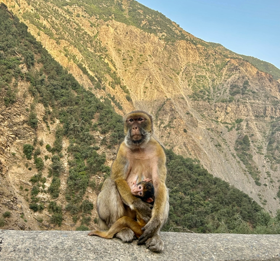

# Introduction

The Barbary Macaque (Macaca sylvanus)  is North Africa’s only primate and has been classified as endangered by the [IUCN Red list](https://www.iucnredlist.org/search?query=Macaca%20sylvanus&searchType=species) as of 2008. The species occupies a small and heavily fragmented range within forested regions of Morocco and Algeria, along with a small introduced population on Rock of Gibraltar. It faces critical threats from deforestation, urbanization, agriculture, and human disturbances driven by tourism.Materials and methods



Algeria holds nearly 25% of the Barbary Macaque’s population, however there is a crucial need for new reviews of Algerian macaque populations as a recent comprehensive census of the existing populations within the country does not exist (Boumenir et. al , 2025). Even more pressing, recent dry seasons driven by climate change have worsened regional wild fires, which overlap with Algerian macaque habitat. Relevantly, in the summer of 2026 nearly 160 wildfires broke out along the northeastern coast of Algeria. This study aims to map the spatial intersection of 2026 wildfire damage with known macaque habitat to estimate recent habitat loss.

```{r, message=F, warning=F}
#| echo: false
library(tidyverse)
library(leaflet)
library(kableExtra)
library(htmlwidgets)
library(widgetframe)
library(sf)
library(terra)
library(rgbif)
library(geodata)
library(tidyverse)
library(greenSD)
library(dplyr)
library(dygraphs)
```

## Prepare Data

```{r}
#| echo: false
#| warning: false
#| message: false
#1. Define study area bounding box (Northeast Algeria)

# 1.1 define longitude and latitude:
boundbox_coords <- c( xmin = 3.0,
                      ymin = 36.3,
                      xmax = 8.6,
                      ymax = 37.2)


#2. Create an sf bounding box polygon + set crs
# 2.1 set an sfc object to hold spatial geometries:
boundbox_poly <- st_as_sfc(st_bbox(boundbox_coords, crs = 4326))
#view(boundbox_poly) # 2.2 check that polygon returns intended geography
#plot(boundbox_poly) # 2.3 draws a rectangle with no data
```

## 1. ESA WorldCover For Tree Cover Data

Land cover data downloaded from ESA World Cover from the year 2021, masked to Tree Cover.

```{r}
#| echo: false
#| label: download_landcover
#| cache: true 
#| warning: false 
#| message: false

#1 Download ESA landcover to desired extent
lancov_extent <- get_esa_wc(bbox = boundbox_poly, year = 2021, datatype = "landcover", mask = TRUE, quiet = TRUE )
plot(lancov_extent) #view
# 1.2 isolate tree cover data: numeric code "10"
tree_cover <- ifel(lancov_extent == 10, lancov_extent, NA) # 1.3 treats all other data as NA 
levels(tree_cover) <- data.frame(id = 10, cover = "Tree Cover") # 1.4 renames legend to "tree_cover" 
plot(tree_cover, main = "Tree Cover In Northeast Algeria", col = "forestgreen")
```

## 2. Species Occurrence Points

Plot occurrence points of Barbary Macaque

```{r}
#| echo: false
#| label: download_occ_pt
#| cache: true 
#| warning: false 
#| message: false 
#2. Download species point data at desired extent 
bounding_box <- st_as_text(boundbox_poly) # 2.1 translates polygon to text  
occ_data <- occ_search(scientificName = "Macaca sylvanus", hasCoordinate = TRUE, geometry = bounding_box ) # 2.2 pulls occurance data with coord info within bounding box 
occ_df <- occ_data$data # 2.3 extracts cleaned observation records 
occ_sf <- st_as_sf(occ_df, 
                   coords = c("decimalLongitude", "decimalLatitude"), 
                   crs = 4326, 
                   remove = FALSE) # 2.4 converts occurence data to sf object 

# == 2.5 run a test plot to see if points fall in desired study area == # 
plot(tree_cover, main = "Tree Cover & Macaca sylvanus Occurrences", col = "forestgreen")
plot(st_geometry(occ_sf), col = "orange", pch = 16, cex = 0.5, add = TRUE)
```

## 3. Species Range Map

```{r}
#| echo: false
#| label: download_sp_range
#| cache: true
#| warning: false 
#| message: false 
#3. Download IUCN redlist species bounds at desired extent 
IUCN_range <- st_read("data/MacacaSylHab_range/T12561A50043570.gpkg") # 3.1 read in range data 
macaque_range <- st_transform(IUCN_range, crs = 4326) |> st_crop(boundbox_poly) # 3.2 crop to study area 

# == 3.3 run a test plot to ensure study area covers range == # 
plot(tree_cover, main = "Tree Cover & IUCN Macaque Range", col = "forestgreen")
plot(st_geometry(macaque_range), border = "red", lwd = 1.0, add = TRUE) #note to self : make some adjustments to bounding_box 
```

## \[\~200 words\]

Tables and figures (maps and other graphics) are carefully planned to convey the results of your analysis. Intense exploration and evidence of many trials and failures. The author looked at the data in many different ways before coming to the final presentation of the data.

Show tables, plots, etc. and describe them.

### Dygraphs Example

# Conclusions

\[\~200 words\]

Clear summary adequately describing the results and putting them in context. Discussion of further questions and ways to continue investigation.

# References

All sources are cited in a consistent manner
